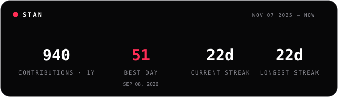
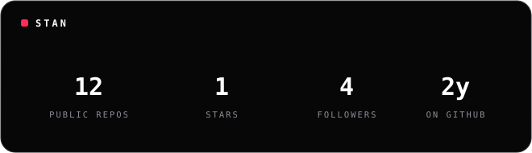

<h1 align="center">mxsourav</h1>

  <picture>
    <source media="(prefers-color-scheme: dark)" srcset="https://readme-typing-svg.demolab.com?font=JetBrains+Mono&weight=600&size=22&duration=2800&pause=1000&color=FF2D55&center=true&vCenter=true&width=700&lines=Embedded+systems+%C2%B7+firmware;Reverse+engineering+%C2%B7+RF+%C2%B7+IoT;Building+ST%CE%94N+studio+%E2%80%94+AI-powered+3D+printing" />
    
  </picture>

  

  

  carbon <b>#070708</b> · <b>STΔN</b> studio · on-device

